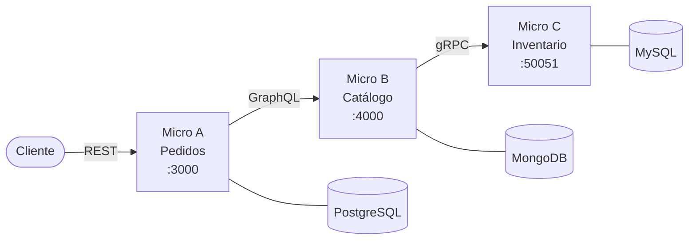

# Tienda Microservicios

Mini tienda en línea construida con **3 microservicios** que se comunican por **REST, GraphQL y gRPC**. Cada microservicio tiene su **propia base de datos** y un motor distinto. Todo el sistema arranca con un solo comando usando Docker Compose.

## Arquitectura



| Micro | Responsabilidad | Expone | Consume | Base de datos |
|---|---|---|---|---|
| **A: Pedidos** | Crear y consultar pedidos | REST | GraphQL (hacia B) | PostgreSQL 16 |
| **B: Catálogo** | Productos, nombres y precios | GraphQL | gRPC (hacia C) | MongoDB 7 |
| **C: Inventario** | Stock y reservas | gRPC | — | MySQL 8 |

### Flujo de "crear pedido"

1. El cliente envía `POST /orders` a **A** solo con `sku` y `cantidad` (nunca con el precio).
2. **A** consulta a **B** por GraphQL (`productoPorSku`) el nombre y precio reales.
3. **A** pide a **B** reservar el stock (`reservarStock`); **B** lo delega a **C** por gRPC, que descuenta el inventario.
4. **A** guarda el pedido y sus ítems en PostgreSQL dentro de una transacción.

Si un ítem no tiene stock, o falla el guardado, **A** compensa liberando (`liberarStock`) lo ya reservado, de modo que el inventario nunca queda descontado por pedidos inexistentes.

## Stack

- **Node.js 20 + TypeScript** (ejecutado con `tsx`)
- **A:** Express + `pg`
- **B:** Apollo Server (GraphQL) + driver `mongodb` + cliente gRPC
- **C:** `@grpc/grpc-js` + `mysql2`
- **Docker Compose** para orquestar los 3 servicios y las 3 bases de datos

## Cómo ejecutar

**Requisitos:** Docker Desktop.

```bash
git clone https://github.com/ErikSantiago-G/MicroServicesFinal.git
cd MicroServicesFinal
docker compose up --build
```

Servicios disponibles:

| Servicio | URL / puerto |
|---|---|
| Pedidos (REST) | http://localhost:3000 |
| Catálogo (GraphQL, con explorador de Apollo) | http://localhost:4000 |
| Inventario (gRPC) | `localhost:50051` |
| PostgreSQL / MongoDB / MySQL (desde el host) | `5433` / `27018` / `3307` |

Para apagar: `docker compose down`. Para reiniciar con los datos iniciales: `docker compose down -v`.

## Datos de ejemplo

| SKU | Producto | Precio | Stock inicial |
|---|---|---|---|
| `LAP-001` | Laptop Pro 14 | 3.200.000 | 10 |
| `MOU-001` | Mouse inalámbrico | 85.000 | 50 |
| `TEC-001` | Teclado mecánico | 250.000 | 25 |

El **SKU** es la clave compartida entre catálogo e inventario.

## API

### A: Pedidos (REST)

| Método | Ruta | Descripción |
|---|---|---|
| `POST` | `/orders` | Crea un pedido (`cliente` e `items` con `sku` y `cantidad`) |
| `GET` | `/orders` | Lista los pedidos |
| `GET` | `/orders/:id` | Consulta un pedido con sus ítems |

Códigos de error de `POST /orders`: `400` datos inválidos, `404` SKU inexistente, `409` sin stock, `502` fallo al comunicarse con el catálogo.

**Ejemplo (PowerShell):**

```powershell
$body = '{"cliente":"Santiago","items":[{"sku":"LAP-001","cantidad":1},{"sku":"MOU-001","cantidad":2}]}'
Invoke-RestMethod -Uri http://localhost:3000/orders -Method Post -ContentType "application/json" -Body $body
```

**Ejemplo (curl):**

```bash
curl -X POST http://localhost:3000/orders \
  -H "Content-Type: application/json" \
  -d '{"cliente":"Santiago","items":[{"sku":"LAP-001","cantidad":1}]}'
```

### B: Catálogo (GraphQL)

Endpoint: `http://localhost:4000/`

```graphql
type Query {
  productos: [Producto!]!
  producto(id: ID!): Producto
  productoPorSku(sku: String!): Producto
}

type Mutation {
  crearProducto(input: ProductoInput!): Producto!
  reservarStock(sku: String!, cantidad: Int!): ResultadoReserva!
  liberarStock(sku: String!, cantidad: Int!): ResultadoReserva!
}
```

El campo `stock` de `Producto` solo consulta a C (gRPC) cuando el cliente lo pide.

```graphql
query {
  productos { sku nombre precio stock }
}
```

### C: Inventario (gRPC)

El contrato está en [`proto/inventario.proto`](proto/inventario.proto) y lo comparten B y C.

| RPC | Descripción |
|---|---|
| `ConsultarStock` | Devuelve la cantidad disponible de un SKU |
| `ReservarStock` | Descuenta stock con un único `UPDATE` condicionado (atómico) |
| `LiberarStock` | Devuelve stock (compensación) |

## Estructura del repositorio

```
.
├── docker-compose.yml
├── proto/
│   └── inventario.proto          # contrato gRPC compartido
├── pedidos-service/              # Micro A (REST + PostgreSQL)
│   ├── db/init.sql
│   └── src/ (index.ts, catalogoClient.ts)
├── catalogo-service/             # Micro B (GraphQL + MongoDB)
│   └── src/ (index.ts, inventarioClient.ts)
└── inventario-service/           # Micro C (gRPC + MySQL)
    ├── db/init.sql
    └── src/ (index.ts, test-client.ts)
```

## Desarrollo local (sin Docker para los servicios)

Levanta solo las bases de datos y corre cada servicio en su propia terminal, de abajo hacia arriba:

```bash
docker compose up -d mysql-inventario mongo-catalogo postgres-pedidos

cd inventario-service && npm install && npm run dev   # terminal 1
cd catalogo-service   && npm install && npm run dev   # terminal 2
cd pedidos-service    && npm install && npm run dev   # terminal 3
```

Dentro de Docker los servicios se encuentran por nombre (`inventario:50051`, `http://catalogo:4000/`) mediante variables de entorno; en local usan `localhost` por defecto.

## Cumplimiento de la rúbrica

| Requisito | Puntos | Dónde se cumple |
|---|---|---|
| Micro A (Pedidos) con su propia BD | 1.0 | `pedidos-service/`, PostgreSQL |
| Micro B (Catálogo) con su propia BD | 1.0 | `catalogo-service/`, MongoDB |
| Micro C (Inventario) con su propia BD | 1.0 | `inventario-service/`, MySQL |
| Comunicación A ↔ B por **GraphQL** | 1.0 | `pedidos-service/src/catalogoClient.ts` → `catalogo-service/src/index.ts` |
| Comunicación B ↔ C por **gRPC** | 1.0 | `catalogo-service/src/inventarioClient.ts` → `inventario-service/src/index.ts` |
| **Total** | **5.0** | |

Adicional: **REST** como método de comunicación elegido para exponer A a clientes externos.

## Decisiones de diseño

- **Una BD por microservicio, motores distintos:** demuestra independencia entre servicios.
- **El cliente nunca envía precios:** A los obtiene de B, así nadie puede falsear el valor de un pedido.
- **Reserva atómica de stock:** un solo `UPDATE ... WHERE cantidad >= ?` evita vender más unidades de las existentes cuando hay pedidos simultáneos.
- **Compensación:** si falla un ítem o el guardado del pedido, se libera el stock ya reservado.
- **Transacción en A:** el pedido y sus ítems se guardan juntos o no se guardan.
